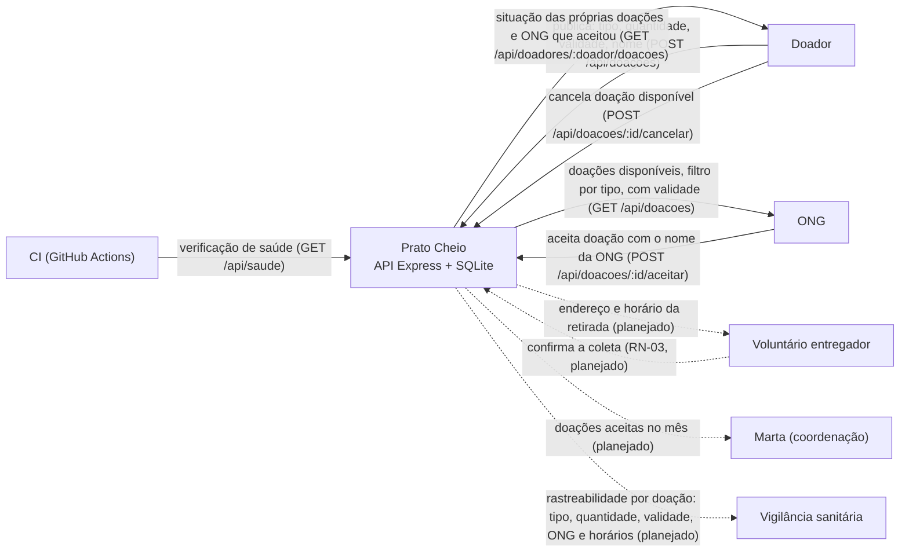

**Pergunta:** quem troca dados com o Prato Cheio, e quais dados?
**Decisão que sustenta:** decisão 4 (doador identificado pelo nome, sem login: não há seta de cadastro nem de autenticação) e a fronteira do sistema na API.
**Situação:** retrato do código no commit `64a4dde` (entra na `main` pelo merge do PR #5). As setas tracejadas são proposta: ainda não têm rota.

# Diagrama de contexto — Prato Cheio

7 elementos. Linha cheia: rota que existe no commit acima. Linha tracejada: proposta.

## Por que Marta e a vigilância sanitária aparecem

Na versão anterior (`Diagrama de contexto.svg`, Aula 7) as duas ficavam de fora, porque nenhuma
operava a API. Elas entram agora como destino de dados que o sistema precisa entregar:

- **Vigilância sanitária:** a RN-01 existe por causa dela. Os três campos obrigatórios da
  publicação, junto com a ONG que aceitou e os horários, são o registro que ela pode pedir num
  incidente sanitário. Ainda não há rota: hoje esse registro está só no banco.
- **Marta:** acompanha o resultado do piloto (doações aceitas no mês). Também sem rota ainda.

O SVG e o PDF desta pasta são a versão da Aula 7 e ficam como histórico. Neles faltam Marta,
vigilância sanitária, o cancelamento e a consulta do doador.
