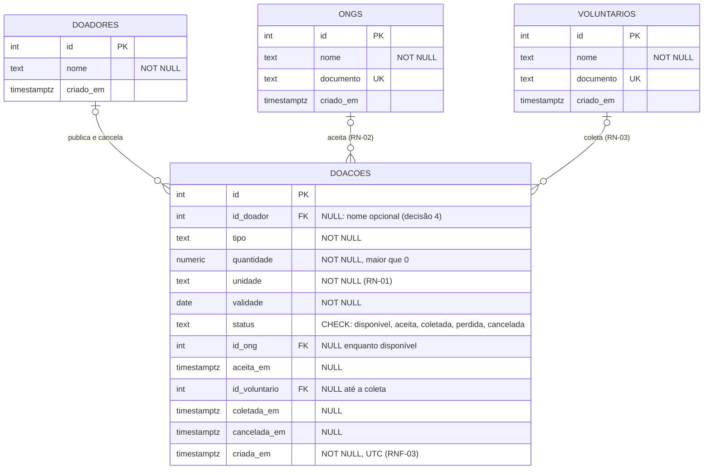

**Pergunta:** onde fica cada fato da doação (quem publicou, quem aceitou, quem coletou e quando) para que o aceite seja exclusivo e a doação rastreável?
**Decisão que sustenta:** decisão 1 (o estado mora na própria doação, sem tabela de reservas: o aceite é um `UPDATE` da linha) e decisão 4 (doador opcional, sem login).
**Situação:** proposta, ainda não implementada. O código no commit `64a4dde` tem só a tabela `doacoes`; as três divergências estão em [`docs/projeto.md` § Diagramas](../projeto.md#diagramas).

# Modelo de dados — Prato Cheio

4 elementos. Cada doação tem no máximo uma ONG (`|o`), e a exclusividade vem do `UPDATE`
condicional da decisão 1, não de uma tabela à parte. O status `cancelada` e a coluna
`cancelada_em` vieram da história "doador cancela uma doação disponível" (etapa 6).

`DOADORES` não tem `documento`: a decisão 4 dispensa cadastro do doador, e um documento
obrigatório seria o primeiro passo de um login.

Histórico: o modelo da Aula 7 está em `Modelo de dados.pdf` e `Modelo de dados final.svg`, e a
revisão com IA está em `Revisão com IA - Modelo de dados.md`.
